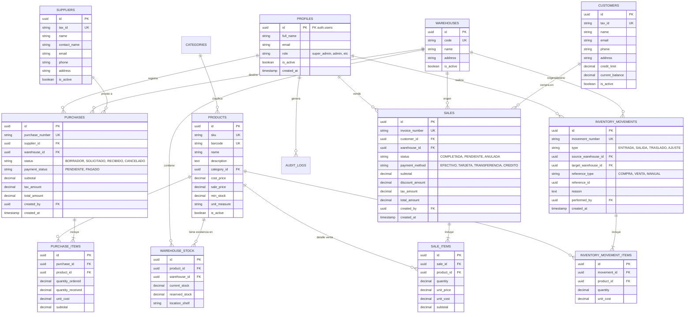
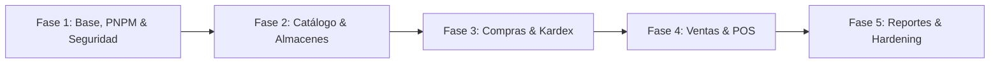

# Planificación y Especificación Técnica: Sistema Administrativo ERP

> **Documento:** Plan de Arquitectura, Requisitos y Diseño de Software Administrativo  
> **Estado:** Aprobado para Desarrollo  
> **Acceso:** Sistema Privado (Restringido / Sin Registro Público)  
> **Stack Principal:** Next.js (App Router + Server Actions) + Supabase (PostgreSQL, Auth, RLS, Storage)

---

## 1. Visión General del Proyecto

El objetivo es desarrollar un **Software Administrativo (ERP Ligero)** moderno, altamente seguro, robusto y responsivo, diseñado para centralizar y optimizar las operaciones críticas de una empresa:
- **Control de Inventarios Multialmacén** en tiempo real.
- **Trazabilidad Completa (Kardex)** de entradas, salidas, mermas y traslados.
- **Gestión de Compras y Proveedores** con actualización automática de stock y costos.
- **Punto de Venta (POS) y Facturación** ágil con soporte para lectores de código de barras.
- **Gestión de Clientes y Créditos**.
- **Control de Usuarios y Roles** bajo un modelo estricto de invitación privada.

### Principios Clave de Diseño
1. **Seguridad "Zero-Trust"**: Ninguna acción se confía al cliente; todo permiso y cambio de stock se valida y ejecuta en la base de datos (PostgreSQL RLS y funciones transaccionales).
2. **Acceso Exclusivo / Sin Registro Público**: No existen formularios de autoregistro. Solo usuarios autorizados e invitados por el Administrador pueden ingresar.
3. **UI/UX Intuitiva y Amigable**: Diseñado tanto para operadores de bodega (en móviles o lectores portátiles) como para administrativos y gerentes en pantallas de escritorio.
4. **Integridad de Datos**: Cero inconsistencias en inventario mediante transacciones atómicas con bloqueos (`SELECT ... FOR UPDATE`).

---

## 2. Pila Tecnológica Recomendada (Tech Stack)

| Capa | Tecnología | Justificación y Ventajas |
| :--- | :--- | :--- |
| **Gestor de Paquetes** | **PNPM (Obligatorio / No NPM)** | Eficiencia extrema de almacenamiento (content-addressable store), instalaciones 3x más rápidas, estructura estricta de `node_modules` que previene dependencias fantasma (seguridad reforzada) y bloqueo determinista vía `pnpm-lock.yaml`. |
| **Framework Fullstack** | **Next.js 15 (App Router)** | Renderizado híbrido (SSR para páginas protegidas, React Server Components para máxima velocidad), Server Actions para mutaciones seguras sin endpoints API expuestos innecesariamente. |
| **Lenguaje** | **TypeScript** | Tipado estático de extremo a extremo, autocompletado y sincronización directa con los esquemas de PostgreSQL en Supabase. |
| **Base de Datos & Auth** | **Supabase (PostgreSQL)** | PostgreSQL nativo, Row Level Security (RLS), Triggers en PL/pgSQL, Webhooks, Supabase Auth con SSR seguro y Storage para imágenes de productos/comprobantes. |
| **Estilos & Diseño** | **Tailwind CSS + shadcn/ui** | Componentes de UI accesibles (Radix UI), totalmente personalizables, responsivos, ligeros y con soporte nativo de modo oscuro/claro. |
| **Tablas de Datos** | **TanStack Table v8** | Manejo ultraeficiente de tablas administrativas con ordenamiento, filtrado multifactor, paginación en servidor y selección masiva. |
| **Formularios & Validación** | **React Hook Form + Zod** | Validación declarativa y consistente compartida entre el formulario del cliente y el Server Action en el backend. |
| **Iconografía** | **Lucide React** | Iconos limpios, consistentes y adaptados a sistemas de gestión empresarial. |
| **Reportes & Facturas** | **@react-pdf/renderer** | Generación de facturas, albaranes, reportes de inventario y etiquetas de códigos de barras en PDF vectorial o impresión térmica estándar (80mm/58mm). |
| **Escáner de Código de Barras** | **html5-qrcode** + Listener USB | Permite escanear con la cámara de un teléfono/tablet o conectar lectores láser USB/Bluetooth directos como entrada de teclado. |

### 2.1. Política Estricta de Gestión de Paquetes: Exclusividad PNPM
Queda **estrictamente prohibido el uso de `npm` o `yarn`** en este proyecto. Todo el ciclo de vida de dependencias, scripts y herramientas CLI se ejecutará única y exclusivamente a través de **PNPM**.

#### Justificación Técnica y de Seguridad:
1. **Prevención de Dependencias Fantasma (Phantom Dependencies):** `npm` aplana el árbol de dependencias (`flat node_modules`), permitiendo que el código importe paquetes secundarios no declarados en `package.json`. `pnpm` utiliza enlaces simbólicos y duros aislados, garantizando que el proyecto solo acceda a las dependencias explícitamente autorizadas.
2. **Eficiencia en Disco y Rendimiento:** Comparte un almacén centralizado direccionable por contenido (`content-addressable store`), reduciendo drásticamente el espacio consumido y acelerando instalaciones hasta 3 veces en comparación con `npm`.
3. **Bloqueo Determinista Inmutable:** El archivo de control de versiones será exclusivamente `pnpm-lock.yaml`.

#### Mecanismos de Bloqueo de NPM:
- **Script de Bloqueo en `package.json`:**
  ```json
  {
    "packageManager": "pnpm@9.15.0",
    "scripts": {
      "preinstall": "npx only-allow pnpm"
    }
  }
  ```
  *(Si algún desarrollador intenta ejecutar accidentalmente `npm install`, el script abortará la ejecución de inmediato con un error).*
- **Archivo de Configuración `.npmrc`:**
  ```ini
  engine-strict=true
  auto-install-peers=true
  ```

#### Comandos Canónicos del Proyecto:
- **Inicializar Proyecto:**  
  `pnpm create next-app@latest . --typescript --tailwind --eslint --app --src-dir --import-alias "@/*"`
- **Instalar Dependencias:**  
  `pnpm add @supabase/supabase-js @supabase/ssr @tanstack/react-table zod react-hook-form lucide-react sonner`
- **Instalar Componentes UI (shadcn):**  
  `pnpm dlx shadcn@latest init`  
  `pnpm dlx shadcn@latest add button dialog table input badge dropdown-menu`
- **Servidor de Desarrollo y Construcción:**  
  `pnpm dev` / `pnpm build` / `pnpm start`

---

## 3. Estrategia de Seguridad Integral (Prioridad Máxima)

Al tratarse de un sistema administrativo con información financiera, de stock y de clientes, la seguridad está diseñada por capas:

```
[ Usuario / Navegador ]
         │ (HTTPS / TLS 1.3 + Cookies HTTP-Only)
         ▼
[ Next.js Middleware ] ──► Verifica sesión JWT válida y rol permitido antes de cargar la ruta
         │
         ▼
[ Server Components & Server Actions ] ──► Validación de esquemas con Zod + Sanitización
         │ (Conexión segura Supabase SSR)
         ▼
[ Supabase PostgreSQL ]
   ├──► [ Row Level Security (RLS) ] (Filtra acceso a nivel de fila según rol y usuario)
   ├──► [ Funciones Transaccionales PL/pgSQL ] (Garantiza integridad de inventario y compras)
   └──► [ Triggers de Auditoría Inmutable ] (Registra quién modificó qué, cuándo y valor previo)
```

### 3.1. Acceso Privado y Restricción de Registro
- **Desactivación de Registro Público**: En el panel de Supabase Auth se inhabilita la opción `Allow new users to sign up`.
- **Flujo de Alta de Usuarios**:
  1. Un usuario con rol `Super Admin` o `Administrador` ingresa al módulo de Usuarios.
  2. Proporciona el correo, nombre y asigna el rol correspondiente.
  3. El sistema invoca `supabase.auth.admin.inviteUserByEmail()`.
  4. El usuario recibe un enlace seguro por correo para establecer su contraseña e iniciar sesión por primera vez.
- **Baja Inmediata**: Al cambiar el estado de un usuario a `is_active = false` en la base de datos, el middleware de Next.js revoca inmediatamente su sesión activa.

### 3.2. Control de Acceso Basado en Roles (RBAC)

Se definen los siguientes roles con privilegios granulares:

| Rol | Inventario / Almacén | Compras | Ventas | Clientes | Usuarios / Config | Reportes |
| :--- | :---: | :---: | :---: | :---: | :---: | :---: |
| **Super Admin** | Total | Total | Total | Total | Total | Total |
| **Administrador** | Total | Total | Total | Total | Gestión (sin super) | Total |
| **Encargado Almacén** | Edición / Movimientos | Solo Recepción | Solo Consulta | Sin Acceso | Sin Acceso | Stock / Kardex |
| **Comprador** | Consulta | Total | Sin Acceso | Sin Acceso | Sin Acceso | Compras |
| **Vendedor / Cajero** | Solo Consulta | Sin Acceso | Creación / Cobro | Creación / Edición | Sin Acceso | Cierre de Caja |
| **Auditor / Contador** | Solo Lectura | Solo Lectura | Solo Lectura | Solo Lectura | Sin Acceso | Total (Lectura) |

### 3.3. Row Level Security (RLS) en Supabase
El 100% de las tablas tendrán RLS activado de forma obligatoria (`FORCE ROW LEVEL SECURITY`).
- Las consultas nunca confían en IDs enviados por el cliente.
- Las políticas de RLS verifican contra una función SQL `auth.role()` o `public.get_user_role()`.
- Ejemplo de política conceptual:
  ```sql
  -- Solo usuarios activos con roles específicos pueden registrar ventas
  CREATE POLICY "Permitir crear ventas a vendedores y administradores"
  ON public.sales FOR INSERT
  TO authenticated
  WITH CHECK (
    EXISTS (
      SELECT 1 FROM public.profiles
      WHERE profiles.id = auth.uid()
        AND profiles.is_active = true
        AND profiles.role IN ('super_admin', 'admin', 'vendedor')
    )
  );
  ```

### 3.4. Transacciones ACID y Prevención de Condiciones de Carrera (Race Conditions)
Para evitar que dos vendedores vendan el último producto al mismo milisegundo:
- Las ventas y traslados se ejecutan a través de **Funciones Almacenadas (RPC)** en PostgreSQL.
- Se utiliza `SELECT ... FOR UPDATE` para bloquear la fila de stock durante la operación de resta.
- Si el stock resultante es menor a cero, se dispara un `ROLLBACK` automático con un error descriptivo.

### 3.5. Registro de Auditoría (Audit Trail)
- Una tabla dedicada `audit_logs` almacena cualquier inserción, modificación o eliminación en tablas críticas (`products`, `sales`, `purchases`, `inventory_movements`, `profiles`).
- Un trigger universal en PostgreSQL captura:
  - `user_id` del autor.
  - `action` (`INSERT`, `UPDATE`, `DELETE`).
  - `table_name`.
  - `old_data` (JSONB con el estado anterior).
  - `new_data` (JSONB con el nuevo estado).
  - `created_at` (Timestamp inmutable).

### 3.6. Seguridad de la Aplicación en Next.js
- **Cookies Seguras**: Las credenciales de sesión se gestionan mediante cookies con atributos `HttpOnly`, `Secure` y `SameSite=Lax` utilizando el paquete `@supabase/ssr`.
- **Headers HTTP de Protección**:
  - `Content-Security-Policy` (CSP) para prevenir Cross-Site Scripting (XSS).
  - `X-Frame-Options: DENY` para evitar Clickjacking.
  - `X-Content-Type-Options: nosniff`.
  - `Strict-Transport-Security` (HSTS).
- **Rate Limiting**: Protección en la ruta de autenticación para mitigar ataques de fuerza bruta.

---

## 4. Modelo de Datos y Esquema de Base de Datos

### Diagrama Entidad-Relación (Mermaid)



---

## 5. Desglose Detallado de Módulos Funcionales

### 5.1. Módulo de Autenticación y Usuarios
- **Pantalla de Inicio de Sesión**:
  - Diseño minimalista, centrado y limpio.
  - Campos: Correo electrónico y contraseña (con opción de mostrar/ocultar).
  - Protección contra ataques de fuerza bruta (bloqueo temporal tras intentos fallidos).
  - Soporte opcional para Autenticación de Dos Factores (TOTP con Supabase MFA).
  - *No incluye enlace de "Crear cuenta" o "Registrarse"*.
- **Gestión de Usuarios (Administración)**:
  - Listado con estado (Activo / Inactivo), último acceso y rol.
  - Botón "Invitar Usuario" (abre modal para ingresar datos y enviar invitación oficial por email).
  - Edición de perfiles y cambio de roles al instante.
  - Interruptor (Switch) para suspender/desactivar acceso de inmediato.

### 5.2. Módulo de Almacenes y Ubicaciones
- Múltiples almacenes físicos (ej: "Almacén Central", "Sucursal Norte", "Bodega de Envíos").
- Configuración de datos de contacto, responsable del almacén y dirección.
- Gestión de pasillos / estanterías / niveles (`location_shelf`) para facilitar la localización rápida de productos.
- Vista de stock filtrable por almacén individual o consolidado global.

### 5.3. Módulo de Catálogo de Productos e Inventario
- **Campos del Producto**:
  - Código interno (SKU) y Código de barras universal (EAN-13, UPC o Code128).
  - Nombre, descripción, categoría y marca.
  - Unidad de medida (Pieza, Kg, Litro, Caja, etc.).
  - Precio de costo y Precio de venta con cálculo automático de margen de utilidad (%).
  - Alerta de Stock Mínimo y Stock Máximo.
  - Galería de imágenes (almacenadas en Supabase Storage con compresión WebP).
- **Operaciones Rápidas**:
  - Búsqueda en vivo (debounce) por nombre, SKU o escaneo instantáneo con lector.
  - Generador e impresor de etiquetas con código de barras en formato PDF.
  - Exportación de catálogo a Excel / CSV.

### 5.4. Módulo de Movimientos de Inventario (Kardex)
- **Registro Centralizado de Movimientos**:
  - **Entradas**: Compras a proveedores, ajustes positivos por inventario físico o devoluciones de clientes.
  - **Salidas**: Ventas a clientes, mermas, productos dañados o devoluciones a proveedores.
  - **Traslados entre Almacenes**: Flujo en dos pasos (Salida en tránsito desde Almacén Origen -> Confirmación de recepción en Almacén Destino).
- **Vista Kardex por Producto**:
  - Histórico cronológico inalterable: Fecha, Tipo de Movimiento, Documento de Referencia, Entrada, Salida, Saldo Final y Costo Unitario/Total.

### 5.5. Módulo de Compras y Proveedores
- **Directorio de Proveedores**:
  - Razón social, identificación tributaria (RFC, RUT, NIF), persona de contacto, teléfono, correo y condiciones de pago.
- **Órdenes de Compra**:
  - Estados: `Borrador` ➔ `Solicitado` ➔ `Recibido Parcial` ➔ `Recibido Total` ➔ `Cancelado`.
  - Al marcar una compra como `Recibida`:
    - Se genera automáticamente el movimiento de entrada en inventario para el almacén seleccionado.
    - Se recalcula el costo del producto utilizando el método de **Costo Promedio Ponderado**.

### 5.6. Módulo de Ventas y Punto de Venta (POS)
- **Modo Punto de Venta Rápido (POS)**:
  - Diseñado para operar con velocidad mediante atajos de teclado (`F1` Buscar, `F2` Cobrar, `ESC` Cancelar).
  - Búsqueda y adición de productos automática al escanear el código de barras.
  - Selección rápida de cliente (con opción de "Consumidor Final" por defecto).
  - Soporte de múltiples métodos de pago (Efectivo con cálculo de cambio, Tarjeta, Transferencia, Crédito).
  - Validación de stock en tiempo real: impide agregar cantidades superiores a las existencias físicas en el almacén activo.
- **Emisión de Documentos**:
  - Generación de comprobante en formato Ticket (impresoras térmicas de 80mm/58mm) o Factura A4 en PDF.
  - Envío automático de comprobante por correo electrónico al cliente.

### 5.7. Módulo de Clientes (CRM Básico)
- Perfil del cliente con historial completo de compras.
- Manejo de línea de crédito: Límite asignado, saldo pendiente de pago y estado de cuenta.
- Registro de abonos/pagos a cuentas por cobrar.

### 5.8. Dashboard Ejecutivo y Reportes
- **KPIs Principales**:
  - Total de ventas del día/mes y comparativa con el periodo anterior.
  - Margen bruto y utilidad neta estimada.
  - Valor total del inventario valorizado (al costo y a la venta).
  - Cantidad de productos con stock crítico (bajo el mínimo).
- **Gráficos Dinámicos**:
  - Evolución temporal de ventas vs compras.
  - Top 10 productos más vendidos y categorías más rentables.
- **Reportes Descargables**:
  - Reporte de ventas detallado por cajero/vendedor.
  - Reporte de valorización de inventario por almacén.
  - Reporte de cuentas por cobrar y antigüedad de saldos.

---

## 6. Diseño UI / UX y Responsividad

Para asegurar que cualquier persona (desde el personal de almacén sin conocimientos técnicos hasta la gerencia) pueda usar el sistema con facilidad:

### 6.1. Experiencia Multi-Dispositivo
- **Desktop (Laptops y Monitores Administrativos)**:
  - Barra lateral colapsable con navegación jerárquica clara.
  - Tablas densas con filtros desplegables, ordenamiento por columnas y atajos rápidos.
  - Teclas de acceso rápido (`Ctrl + K` para comando global de búsqueda de productos, clientes o acciones).
- **Tablet (Punto de Venta en Mostrador)**:
  - Botones táctiles de tamaño generoso (mínimo 44x44px).
  - Teclado numérico en pantalla para cobros rápidos.
  - Cuadrícula visual de productos con fotos para categorías frecuentes.
- **Móvil (Personal de Almacén y Auditoría en Bodega)**:
  - Navegación inferior (Bottom Navigation) accesible con una sola mano.
  - Acceso directo al botón flotante de escaneo con la cámara del dispositivo.
  - Formulario de conteo de inventario simplificado con confirmación por vibración y sonido.

### 6.2. Retroalimentación Inmediata y Accesibilidad
- Mensajes tipo "Toast" (notificaciones emergentes con Sonner) para confirmar cada acción (ej: *"Venta #1042 registrada con éxito"*).
- Diálogos de confirmación modal obligatorios para acciones destructivas (anulaciones, mermas, desactivación de usuarios).
- Paleta de colores con contraste accesible (WCAG AA):
  - Éxito / Entradas: Verde esmeralda.
  - Peligro / Salidas / Stock Crítico: Rojo carmín.
  - Advertencia / Tránsito: Ámbar.
  - Primario / Acción: Azul índigo o pizarra elegante.

---

## 7. Estructura Recomendada del Proyecto en Next.js

```
sistema-administrativo/
├── src/
│   ├── app/                          # Next.js App Router
│   │   ├── (auth)/                   # Grupo de rutas de autenticación
│   │   │   ├── login/
│   │   │   │   └── page.tsx          # Login privado (sin registro)
│   │   │   └── layout.tsx
│   │   ├── (dashboard)/              # Rutas protegidas por sesión
│   │   │   ├── layout.tsx            # Sidebar, Header, Breadcrumbs y UserMenu
│   │   │   ├── page.tsx              # Dashboard con métricas y KPIs
│   │   │   ├── inventario/           # Catálogo de productos y stock
│   │   │   ├── movimientos/          # Kardex y traslados
│   │   │   ├── almacenes/            # Sucursales y bodegas
│   │   │   ├── compras/              # Órdenes de compra y recepción
│   │   │   ├── ventas/               # POS y facturación
│   │   │   ├── clientes/             # Directorio y créditos
│   │   │   ├── usuarios/             # Control de accesos y roles (Admin)
│   │   │   └── reportes/             # Informes analíticos y exportaciones
│   ├── components/                   # Componentes reutilizables
│   │   ├── ui/                       # Componentes base shadcn (Button, Dialog, Table...)
│   │   ├── layout/                   # Sidebar, Navbar, MobileNav
│   │   ├── scanner/                  # Componente escáner de códigos de barra
│   │   └── print/                    # Plantillas imprimibles (Ticket, Factura PDF)
│   ├── lib/
│   │   ├── supabase/
│   │   │   ├── client.ts             # Cliente de navegador Supabase
│   │   │   ├── server.ts             # Cliente de servidor para Server Components
│   │   │   └── middleware.ts         # Verificación de sesiones y tokens en cookies
│   │   ├── validators/               # Esquemas Zod (productos, ventas, compras, usuarios)
│   │   └── utils.ts                  # Formateadores de moneda, fechas y cálculos
│   ├── actions/                      # Server Actions (Mutaciones seguras de BD)
│   │   ├── auth.actions.ts
│   │   ├── inventory.actions.ts
│   │   ├── sales.actions.ts
│   │   └── purchases.actions.ts
│   ├── types/                        # Tipos TypeScript generados de Supabase
│   └── middleware.ts                 # Middleware global de protección de rutas
├── supabase/
│   ├── migrations/                   # Scripts SQL de tablas, RLS, triggers y funciones
│   └── config.toml
├── .env.example
├── .npmrc                           # Configuración estricta de PNPM (engine-strict=true)
├── package.json                     # Declaración de packageManager y script de bloqueo
├── pnpm-lock.yaml                   # Lockfile determinista exclusivo (prohibido package-lock.json)
└── README.md
```

---

## 8. Roadmap de Implementación por Fases



### Fase 1: Arquitectura Base, Autenticación y Control de Acceso
- [x] Inicialización del proyecto Next.js 15 mediante **PNPM** (`pnpm create next-app@latest`) con TypeScript, Tailwind CSS y shadcn/ui.
- [x] Configuración del script `preinstall: "npx --yes only-allow pnpm"` y archivo `.npmrc` para restringir `npm` de raíz.
- [x] Configuración del proyecto en Supabase con esquema de perfiles, roles RBAC y migración SQL inicial.
- [x] Implementación de `@supabase/ssr` con cookies HttpOnly y middleware de protección de rutas.
- [x] Bloqueo de auto-registro en Supabase Auth y creación del flujo de invitaciones por email para administradores.
- [x] Creación del layout administrativo responsive (Sidebar, Header, Menú de usuario y navegación móvil).
- [x] Pantalla privada de login y panel de administración de usuarios interactivo.

### Fase 2: Almacenes, Categorías y Catálogo de Productos
- [x] Migración de tablas: `warehouses`, `categories`, `products` y `warehouse_stock` con datos iniciales demostrativos.
- [x] Configuración de RLS para lectura y gestión según roles de inventario.
- [x] Pantalla de gestión de almacenes con ubicaciones físicas (`/almacenes`).
- [x] Pantalla de catálogo de productos interactiva con filtros, búsqueda por SKU y alertas de stock mínimo (`/inventario`).
- [x] Soporte para lectura y generación de códigos de barras en etiquetas SVG imprimibles.

### Fase 3: Proveedores, Compras y Movimientos de Inventario (Kardex)
- [x] Migración de tablas: `suppliers`, `purchases`, `purchase_items`, `inventory_movements` e `inventory_movement_items`.
- [x] Función PL/pgSQL transaccional para recepción de compras y cálculo de costo promedio ponderado.
- [x] Módulo de registro de órdenes de compra y recepción en almacén con actualización automática de stock (`/compras`).
- [x] Módulo de transferencias entre almacenes con confirmación de origen y destino (`/movimientos`).
- [x] Vista del Kardex físico-valorizado por producto con filtros por fecha y almacén.

### Fase 4: Clientes, Punto de Venta (POS) y Facturación
- [x] Migración de tablas: `customers`, `sales` y `sale_items`.
- [x] Función PL/pgSQL atómica para venta con bloqueo (`SELECT FOR UPDATE`) para evitar sobreventa o stock negativo.
- [x] Interfaz de Punto de Venta (POS) ultra rápida con buscador dinámico y soporte de escáner de códigos de barra (`/ventas`).
- [x] Módulo de clientes con control de saldo, historial y límites de crédito (`/clientes`).
- [x] Generación e impresión de ticket de venta en formato térmico (80mm/58mm).

### Fase 5: Reportes, Auditoría, Testing y Despliegue
- [x] Implementación de la tabla `audit_logs` con triggers universales en PostgreSQL y visor interactivo de payloads JSON.
- [x] Construcción del Dashboard principal con métricas de rendimiento y accesos rápidos (`/dashboard`).
- [x] Centro de reportes con analítica de rentabilidad y exportaciones en tiempo real a CSV/Excel de Ventas, Inventario y Clientes (`/reportes`).
- [x] Auditoría de seguridad (validación de RLS, headers HTTP y fallbacks seguros).
- [x] Compilación y verificación de producción completa con **PNPM** (`pnpm build` exitoso en las 14 rutas).

---

## 9. Recomendaciones Finales y Buenas Prácticas

1. **Respaldos Automáticos (Backups)**: Habilitar en Supabase copias de seguridad automáticas diarias (Point in Time Recovery - PITR si el plan lo permite) y un script periódico de volcado lógico (`pg_dump`) almacenado en un almacenamiento secundario frío.
2. **Offline-First Ligero para POS**: Si el internet del local presenta intermitencias ocasionales, implementar un almacenamiento en caché en el navegador (`IndexedDB`) para que el cajero pueda seguir leyendo códigos y encolar las transacciones para su sincronización automática apenas regrese la conexión.
3. **Monitoreo de Errores**: Integrar **Sentry** tanto en el frontend como en las Server Actions para detectar y corregir cualquier fallo operativo de inmediato.
4. **Impresión Térmica Directa**: Para máxima velocidad en el punto de venta, utilizar comandos directos de navegador (`window.print()`) con hojas de estilo CSS optimizadas para papel térmico continuo (ancho fijo de 80mm o 58mm, sin cabeceras ni pies de página del navegador).
